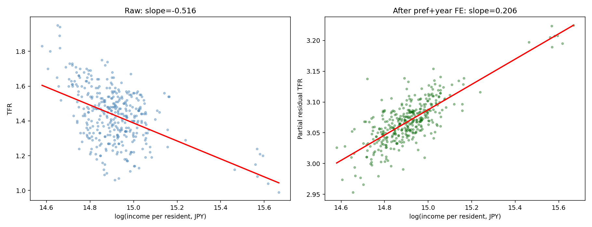

# Japan TFR panel analysis

Panel analysis of prefecture-level total fertility rate (TFR), income per resident and eating-out expenditure, with exploratory import, organic-farming and gardening specifications.

**Repository:** https://github.com/cafeco09/tfr-japan-panel-analysis

## Reproduced results

The repaired pipeline runs on the included CSV files. The earlier README claimed consistently negative income and eating-out associations; **the executed core models do not support that claim**. Coefficient signs and significance depend on the fixed effects used.

| Variable | OLS + year FE | Prefecture FE | Prefecture + year FE |
|---|---:|---:|---:|
| log(income) | −0.444 (0.113) | −1.128 (0.104) | +0.206 (0.085) |
| log(eating out) | −0.026 (0.098) | +0.211 (0.025) | −0.002 (0.023) |
| Observations | 371 | 371 | 371 |
| R² | 0.404 | 0.838 | 0.978 |

Values in parentheses are standard errors clustered by prefecture (47 clusters). In the two-way fixed-effects model, the income p-value is approximately 0.015 and the eating-out p-value is approximately 0.932. These are conditional associations, not causal effects. See [Table 1](output/tables/table1_core.csv) and the [robustness table](output/tables/robustness_table.csv).

### Exploratory results and identification limits

The period-panel models use 324 eligible observations across three period codes, with prefecture and period fixed effects. They produce rank-deficiency warnings. Time-invariant organic and gardening main effects are absorbed by prefecture fixed effects. National import main effects also require an explicit identification check against the included time controls. The reported main-effect coefficients in [Table 2](output/tables/table2_imports_interactions.csv) must not be treated as uniquely identified estimates.

For transparency, Table 2 retains the existing exporter’s numerical output. In specification `i3_cn_x_org`, the China-import × organic interaction is positive (+0.040, SE 0.017), contrary to the earlier README’s description of a negative interaction. This is an exploratory output from a rank-deficient specification, not a validated causal finding. Reported stars do not resolve identification problems.

The `DropSynth` row removes no additional observations from the already observed-income-only core sample. It duplicates the OLS + year-FE result and is not an independent sensitivity test.

## Run locally

Use Python 3.10 or newer. A fresh Python 3.11 environment is a practical option.

```bash
git clone https://github.com/cafeco09/tfr-japan-panel-analysis.git
cd tfr-japan-panel-analysis
python3 -m venv .venv
source .venv/bin/activate
python -m pip install -r requirements.txt
python run_all.py
```

On Windows, activate with `.venv\Scripts\activate` instead. If using Conda, create and activate a separate environment instead of nesting a virtual environment inside Conda:

```bash
conda create -n tfr-japan python=3.11 pip -y
conda activate tfr-japan
python -m pip install -r requirements.txt
python run_all.py
```

Run these commands from the repository root. The runner executes all six analysis/export stages and stops if a stage fails. The console includes coefficient summaries and any statistical warnings. The committed tables and figures are generated outputs; local successful execution must be checked separately.

## Outputs

Generated tables and figures are tracked in Git. Temporary logs and Python environments are ignored.

| Output | Contents |
|---|---|
| [table1_core.csv](output/tables/table1_core.csv) | Three core income/eating-out models |
| [table2_imports_interactions.csv](output/tables/table2_imports_interactions.csv) | Six exploratory period-panel models; identification caveats apply |
| [robustness_table.csv](output/tables/robustness_table.csv) | Core estimates and the duplicate synthetic-exclusion row |
| `output/tables/*.tex` | LaTeX versions of Tables 1 and 2 |
| `output/tables/*.docx` | Word versions of Tables 1 and 2 |
| [scatter_income_tfr.png](output/figures/scatter_income_tfr.png) | Raw income/TFR scatter and partial-residual plot |
| [scatter_pref_means.png](output/figures/scatter_pref_means.png) | Prefecture-mean income/TFR scatter |
| [environment.txt](output/environment.txt) | Python and package versions used for the committed run |



## Data and caveats

The `data/` directory contains 11 CSV files. Included files provide prefecture-year data labelled 2016–2025, period-coded inputs, snapshot context measures, coverage information and source references. Source-file labels and provenance have not been independently audited in this execution exercise.

- Core income models use the observed-income sample for 2016–2023. Five prefecture incomes are missing in 2023; income is unavailable for 2024–2025.
- The loader joins eating-out expenditure from `dated_source_panel_2016_2025.csv` to `input_2016_2023.csv` by prefecture and year, validating a one-to-one match.
- Eating-out expenditure is a capital-city proxy. Measurement error need not bias its coefficient towards zero in these multivariable panel models.
- National imports do not provide prefecture-specific exposure. Shared national shocks remain a concern.
- Organic-farming and gardening measures are snapshots, rather than repeated within-prefecture observations.
- Differences in TFR methodology and release status require review before substantive use. The presence of rows labelled 2025 does not establish that they are final official annual observations.

The code repairs leave source CSVs and existing exploratory formulae unchanged. See [RUN_NOTES.md](RUN_NOTES.md) for repair details and interpretation limits.

## Code layout

- `run_all.py`: pipeline entry point.
- `scripts/_00_load.py`: shared loading and feature construction.
- `scripts/_01_core_models.py`: core models.
- `scripts/_02_imports_no_yearFE.py`: import models with time trends.
- `scripts/_03_eating_out_2024_25.py`: later-year and full-panel eating-out models.
- `scripts/_04_period_panel_interactions.py`: exploratory period models.
- `scripts/_05_plots.py`: figures.
- `scripts/_06_export_tables.py`: CSV, LaTeX and Word exports.

## Licence and attribution

Code is covered by the [MIT licence](LICENSE). Data retain their original source terms; consult the source references in the CSV files. Cite the repository URL and the commit used when reporting results. No `CITATION.cff` is currently included.
