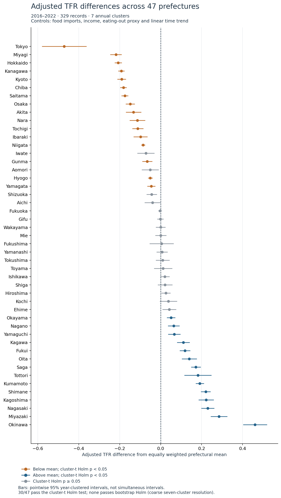
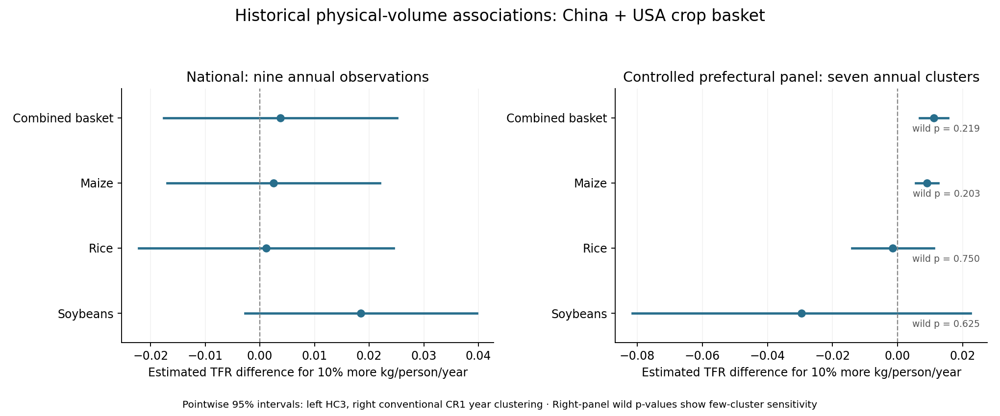
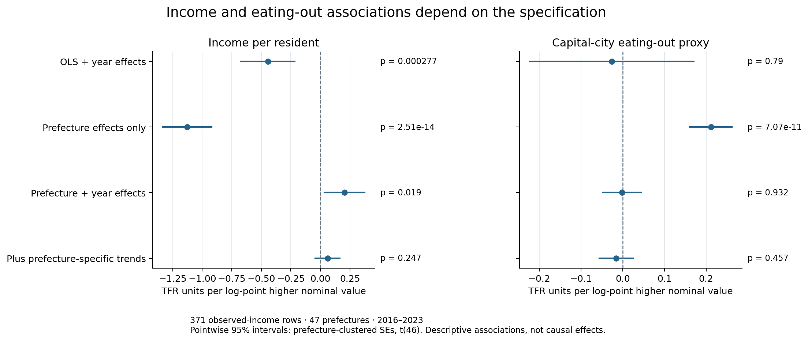
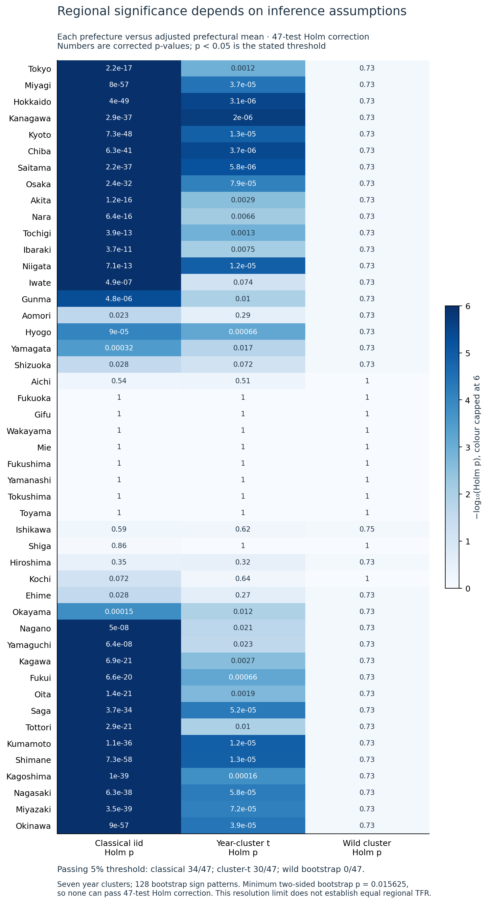
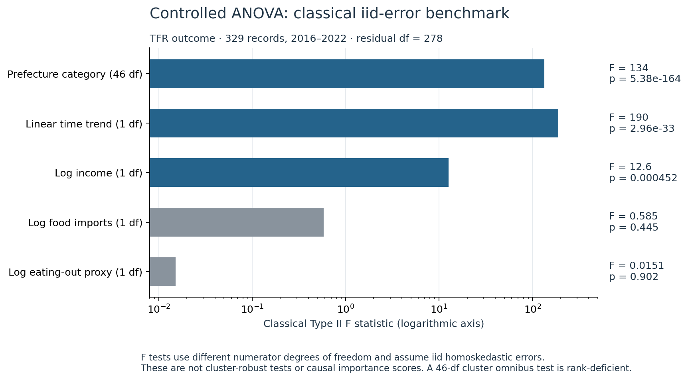
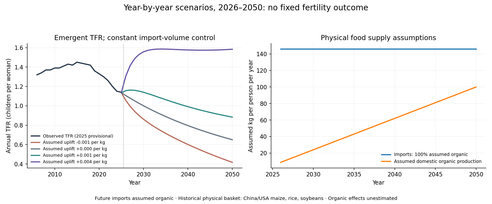

# Food, fertility and possible recovery paths in Japan

**What can food-import patterns tell us about fertility, and what might a shift towards organic food look like?** This project combines historical Japanese data with year-by-year what-if scenarios to explore those questions.

```bash

Reproducibility and better data: The scripts make the current results reproducible. Strengthening the findings will depend on better data, especially a longer history, regional food-consumption records, and measured organic import and production volumes. These would help test the relationships more directly and reduce reliance on assumptions.

We measure food quantities in **kg per person per year**, examine differences across Japan's 47 prefectures, and explore organic imports alongside more organic food grown in Japan. The historical findings and the imagined futures are presented separately so readers can see where the evidence ends and the assumptions begin.

```

## What we found

- **Place mattered.** After allowing for income, eating-out spending and changes over time, 30 prefectures stood out for higher or lower fertility under one testing approach. Tokyo, Hokkaido and Osaka were among the lower-fertility places; Okinawa, Miyazaki and Kumamoto were among the higher-fertility places. These describe fertility differences, not a separate import effect for each place. [Regional results](output/subregion_anova/ANOVA_AND_SUBREGION_SIGNIFICANCE.md).
- **The amount imported revealed a pattern worth following.** In the extended historical sample including the available 2023 records, more imported maize and more of the combined maize/rice/soybean basket were associated with slightly higher fertility after allowing for regional and economic factors. Both positive links passed the small-sample check in that dataset. The shorter balanced sample gave less certain evidence, so the years included matter. [Physical-volume results](output/historical_mass_analysis/HISTORICAL_MASS_RESULTS.md).
- **Income helped explain the picture.** Higher income was associated with higher fertility when persistent regional differences and shared annual changes were taken into account. Allowing each region its own longer-term trend weakened that pattern. [Income and other background factors](output/income_organic_summary/INCOME_ORGANIC_RESULTS.md).

These findings give us more specific questions to investigate: which local conditions matter, which foods people actually consume, and whether changing food supply could make a measurable difference.

## What the historical graphs show

### Higher and lower fertility across Japan

This graph shows which prefectures had higher or lower fertility after allowing for the factors in the model. It describes regional fertility differences; it does not measure a separate food-import effect in each place.



### Food quantities and fertility

The dots show the estimated fertility difference associated with importing 10% more of each crop, measured in kg per person. The lines show uncertainty. The right-hand graph includes regional and economic controls; its extra small-sample checks help show how much confidence to place in the patterns.



The extended sample including available 2023 records gives stronger positive maize and combined-basket associations. [Compare both samples and the dollar-value results](output/historical_mass_analysis/HISTORICAL_MASS_RESULTS.md).

### Income and eating-out spending

These comparisons show how the income and spending patterns change as the model accounts for differences between places and years. Higher income is associated with higher fertility in the model that accounts for both; the relationship becomes less clear when each place also gets its own longer-term trend.



### How the regional findings compare across checks

The first graph compares the regional results under different testing methods. The second shows the contribution of the groups of variables in the conventional ANOVA comparison. They help explain the regional patterns and the checks behind the headline findings.





[All prefecture results](output/subregion_anova/significance_each_prefecture.csv) · [Graph methods and reproduction](output/subregion_anova/figures/README.md) · [Income results](output/income_organic_summary/INCOME_ORGANIC_RESULTS.md)

## A recovery path worth exploring

**In the version where organic food had the bigger assumed benefit, the simulation showed fertility rising from about 1.14 to 1.58 by 2050 - roughly 39% higher.** It reached about 1.56 by 2030 and then stayed close to that level. We did not set a final fertility target; the result came from the quantities and benefit built into the model.

Here, the fertility rate (TFR) means how many children a woman would have if one year's birth rates continued through her childbearing years.

| If organic food provides... | Fertility rate in 2050 |
|---|---:|
| No added benefit | 0.65 |
| A small benefit | 0.88 |
| A bigger benefit | 1.58 |

Even the smaller assumed benefit kept fertility above the no-benefit path throughout the simulation. The bigger benefit made the difference between slowing the decline and turning it around. **Those benefits are assumptions, not effects measured from historical organic-food data.**



### What changed in that imagined future?

- From **2026**, all modelled imports become organic.
- Their quantity stays at about **146 kg per person each year**, keeping general import volume constant for the comparison. Separate checks allow imports to fall or rise 1% annually.
- Organic food grown in Japan rises from an **assumed** 5 kg per person in 2025 to 100 kg in 2050.
- A possible benefit builds gradually. We try different benefit sizes, including zero and a negative response, without choosing the final fertility rate beforehand.

The available physical import basket is **China/USA maize, rice and soybeans**, including possible feed uses. It is not all food or a measure of what people ate. Historical organic status is unknown; the switch to organic is a future scenario assumption.

[Explore the what-if exercise](what-if/organic-food/README.md) · [See every year's results](what-if/organic-food/results/year_by_year_constant_volume_comparison.csv) · [Compare all cases](what-if/organic-food/results/emergent_2050_results.csv)

## How this helps us move forward

The project turns a broad idea into a practical research agenda:

1. **Measure the food people receive.** Separate human food from animal feed and record organic imports and locally grown organic food in physical quantities.
2. **Connect those quantities to places and people.** Regional consumption or individual dietary records would help test whether the national patterns also appear closer to actual exposure.
3. **Test the benefit assumed in the simulation.** The key question is whether organic food is associated with changes in reproductive outcomes, and how large any relationship might be.
4. **Check whether the food changes are achievable.** Examine land, yields, costs and distribution alongside the amounts explored here before treating a scenario as a practical proposal.

The what-if model helps identify the assumptions worth testing. It is a starting point for investigation, not a proven fertility intervention or a forecast of what Japan will experience.

## What supports the results?

| Part of the project | Data or inputs | Where to read more |
|---|---|---|
| Historical food volumes | Actual maize/rice/soybean net weights; matched dollar values for comparison | [Volume report](output/historical_mass_analysis/HISTORICAL_MASS_RESULTS.md) |
| Regional fertility and background factors | Official prefectural TFR, observed income and an eating-out spending proxy | [Regional comparisons](output/subregion_anova/ANOVA_AND_SUBREGION_SIGNIFICANCE.md) · [Income summary](output/income_organic_summary/INCOME_ORGANIC_RESULTS.md) |
| Broad food-import spending | All-origin UN Comtrade food/beverage values; prices and exchange rates can affect these | [Broad-food analysis](output/external_food_imports/EXTERNAL_FOOD_IMPORT_RESULTS.md) |
| Organic-food futures | Estimated historical background plus explicit organic-food assumptions | [Scenario method and inputs](what-if/organic-food/README.md) |

The historical import models have only seven to nine annual exposure values, and those values are national totals shared across prefectures. Findings change with some samples and testing choices; the original idea of a stable negative import-fertility link was not established. Full coefficients, alternative specifications, uncertainty checks and earlier organic-farming diagnostics are retained in the [detailed analysis](docs/detailed_analysis.md). The [source catalogue](Data_Sources.md) records providers, units and coverage, including source-estimated crop weights.

## Reproduce the work

From the repository root, install the dependencies in your Python environment:

```bash
python -m pip install -r requirements.txt
```

Run the historical volume analysis:

```bash
python scripts/_32_crop_mass_data.py
python scripts/_33_historical_mass_regressions.py
```

Run the year-by-year organic-food scenarios:

```bash
python -m pip install -r what-if/organic-food/requirements.txt
python what-if/organic-food/fit_background.py
python what-if/organic-food/run_scenarios.py
```

Saved source records are reused by default. For the broader food-value pipeline, run `python run_all.py`; the original six-stage pipeline remains available with `python run_all.py --legacy`. See the [technical overview](docs/detailed_analysis.md) for setup, model comparisons and additional scripts.

## Sources and licence

Fertility and regional measures come from Japanese official statistics; trade quantities and values come from UN Comtrade. See [Data Sources](Data_Sources.md) for exact files, URLs and retained vintages. Code is [MIT licensed](LICENSE); source data retain their original terms.
