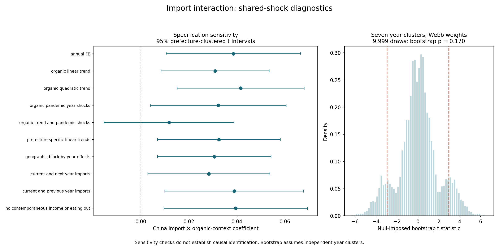

# Income, eating-out and organic-context results

These analyses already existed in the legacy tables and model audits. This page makes their reproduced results visible without carrying forward the earlier unsupported headline that income and eating-out are robustly negative across fixed-effects models.

## Income and eating out

Same observed-income sample for the three core specifications: 371 prefecture-year rows, 47 prefectures, 2016–2023. Standard errors are clustered by prefecture and use a t(46) reference. No synthetic incomes are included. This differs from the 329-row balanced 2016–2022 sample used for the recent import/control ANOVA.

| spec | term | coefficient | p_t46 | ci_low | ci_high | n |
|---|---|---|---|---|---|---|
| OLS_with_year_effects | log_income | -0.44428 | 0.00028 | -0.67141 | -0.21715 | 371.00000 |
| OLS_with_year_effects | log_eating_out | -0.02619 | 0.79000 | -0.22300 | 0.17062 | 371.00000 |
| prefecture_effects_only | log_income | -1.12764 | 0.00000 | -1.33605 | -0.91924 | 371.00000 |
| prefecture_effects_only | log_eating_out | 0.21122 | 0.00000 | 0.16075 | 0.26169 | 371.00000 |
| prefecture_and_year_effects | log_income | 0.20583 | 0.01897 | 0.03547 | 0.37619 | 371.00000 |
| prefecture_and_year_effects | log_eating_out | -0.00195 | 0.93206 | -0.04774 | 0.04384 | 371.00000 |

Income changes from negative in the pooled/year-effect and prefecture-only models to positive after both prefecture and year effects are included (+0.2058, p = 0.0190). Eating-out is essentially zero in the two-way model (−0.00195, p = 0.9321). These are different conditional associations; the pasted negative ranges do not reproduce the current tables.

Adding prefecture-specific trends reduces the income coefficient to +0.0603 (p = 0.2470). This sensitivity prevents describing the positive two-way result as invariant to regional trends. Eating-out in that specification remains non-significant (−0.0152, p = 0.4574).


### Eating-out-only checks in later years

| spec | coefficient | p | n |
|---|---|---|---|
| EO_2016_2024_final_labelled | 0.00889 | 0.66248 | 423.00000 |
| EO_2016_2025_with_provisional | -0.00673 | 0.69765 | 470.00000 |
| EO_2024_2025_only | 0.00734 | 0.84020 | 94.00000 |

The 2024–2025 two-way model gives +0.00734, p = 0.8402, and includes provisional 2025 TFR. It does not reproduce a persistent negative eating-out result. The city-level household spending measure is a proxy; neither the sign nor the direction of measurement-error bias can be assumed.

## Organic context and historical crop imports

| spec | coefficient | p_prefecture_t | ci_low | ci_high | n |
|---|---|---|---|---|---|
| annual_FE | 0.03855 | 0.00808 | 0.01053 | 0.06658 | 324.00000 |
| organic_linear_trend | 0.03093 | 0.00819 | 0.00840 | 0.05345 | 324.00000 |
| organic_trend_and_pandemic_shocks | 0.01171 | 0.38930 | -0.01541 | 0.03882 | 324.00000 |

The full-rank annual-FE China × organic-context interaction is +0.0386 (prefecture-clustered p = 0.0081). Allowing an organic-context trend and differential pandemic-year shocks reduces it to +0.0117 (p = 0.3893). Restricted year-cluster bootstrap p-values are shown below; neither bootstrap confirms the baseline at 5%.

| method | year_clusters | replications | bootstrap_p | monte_carlo_se |
|---|---|---|---|---|
| webb_six_point | 7.00000 | 9999.00000 | 0.17020 | 0.00376 |
| rademacher_enumerated | 7.00000 | 128.00000 | 0.21875 | 0.00000 |



### Interpretation

- Organic context is the standardised share of farms reporting organic activity in the 2020 census, not individual organic-food consumption, certified-only production, chemical residues or local imported-food exposure.
- Its standalone main effect, and the gardening-context main effect, are constant within prefecture and absorbed by prefecture effects. Legacy pseudoinverse coefficients for those main effects are not uniquely identified and must not be reported as substantive estimates.
- The China interaction is positive. Under its model, higher organic context is associated with a more positive import-related TFR slope. This does not identify an absolute import effect or establish that organic farming protects fertility.
- The interaction uses historical China/USA maize-rice-soyabean mass proxies, not the current all-origin BEC food-value measure. Only seven annual exposure observations enter the 324-row 2017–2023 sample.
- Original period labels aggregate year indicators, not observations: the period input contains annual records with year labels removed. The audit recovers years explicitly and fits full-rank annual-FE models.
- Five synthetic 2023 incomes are separate from the observed-income samples. Organic and gardening snapshots are not copied into the current World-food controlled model as annual measurements.

The annual-FE gardening interaction is non-significant (p = 0.7913), but that is not a standalone test of whether gardening affects fertility. When unrestricted organic-context × year effects are allowed, the import × organic interaction is absorbed; distinguishing an import mechanism requires additional identifying assumptions or exposure data.

## Reproduce and inspect

```bash
python scripts/_07_diagnostics.py
python scripts/_25_income_organic_summary.py
```

The summary reads the retained shared-shock/bootstrap audit; regenerate that audit separately with `python scripts/_08_import_identification.py` when deliberately rerunning those checks. `python run_all.py --legacy` reproduces the original six-stage pipeline, but its organic main-effect exports retain rank deficiencies and are historical outputs, not the audited headline evidence.

Full checks: [model audit](../audit/MODEL_AUDIT.md), [shared-shock identification audit](../import_identification/IMPORT_IDENTIFICATION_AUDIT.md), [all original core table entries](../tables/table1_core.csv), and [historical interaction table](../tables/table2_imports_interactions.csv). Sources and scope are in [Data_Sources.md](../../Data_Sources.md).
