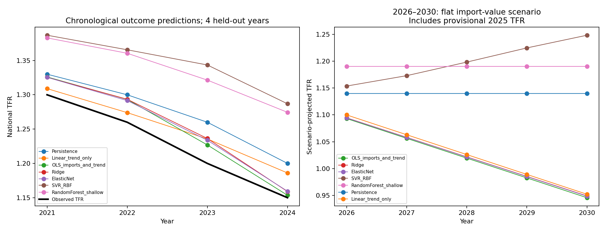

# ML regression, predictive sensitivity and scenario projections

Observed data: national TFR and separate China/USA broad food import values. Primary sample: 2016–2024, nine years. No organic interaction. Synthetic evaluation is separate.

## Chronological comparison

Each outer fit uses only previous years, starting with five training years; outcomes in 2021–2024 are held out in turn. Hyperparameter tuning uses only earlier observations within that outer training set. Scaling is in the fitted pipeline. All four evaluation years and every family are reported.

Contemporaneous import values are supplied at prediction time. This is a conditional chronological hindcast of TFR, not a true advance forecast of imports or an untouched prospective validation exercise. Four errors are too few to establish stable model superiority, calibrated prediction intervals or statistical significance of rankings.

| model | validation_n | MAE | RMSE | max_absolute_error |
|---|---|---|---|---|
| OLS_imports_and_trend | 4.00000 | 0.02246 | 0.02511 | 0.03325 |
| Linear_trend_only | 4.00000 | 0.02370 | 0.02671 | 0.03607 |
| ElasticNet | 4.00000 | 0.02508 | 0.02683 | 0.03380 |
| Ridge | 4.00000 | 0.02607 | 0.02816 | 0.03634 |
| Persistence | 4.00000 | 0.04500 | 0.04637 | 0.06000 |
| RandomForest_shallow | 4.00000 | 0.10732 | 0.10863 | 0.12445 |
| SVR_RBF | 4.00000 | 0.11818 | 0.12041 | 0.14344 |

## Predictive sensitivity to +1% import value

Predictions are recomputed after increasing one country's value by 1%, holding time and the other country fixed. Only changes within marginal training ranges enter the mean. These ranges do not ensure realistic joint combinations. The figures describe the fitted prediction function, not causal responses or physical food quantities.

| model | country | mean_predicted_tfr_change | supported_points | leave_year_out_1pct_min | leave_year_out_1pct_max |
|---|---|---|---|---|---|
| OLS_imports_and_trend | China | 0.00022 | 7.00000 | -0.00105 | 0.00199 |
| OLS_imports_and_trend | USA | 0.00197 | 8.00000 | 0.00158 | 0.00287 |
| Ridge | China | 0.00018 | 7.00000 | -0.00116 | 0.00185 |
| Ridge | USA | 0.00195 | 8.00000 | 0.00158 | 0.00289 |
| ElasticNet | China | 0.00003 | 7.00000 | -0.00071 | 0.00173 |
| ElasticNet | USA | 0.00190 | 8.00000 | 0.00142 | 0.00279 |
| SVR_RBF | China | 0.00057 | 7.00000 | -0.00191 | 0.00168 |
| SVR_RBF | USA | 0.00150 | 8.00000 | 0.00077 | 0.00251 |
| RandomForest_shallow | China | -0.00104 | 7.00000 | -0.00174 | 0.00019 |
| RandomForest_shallow | USA | 0.00126 | 8.00000 | -0.00017 | 0.00515 |

Leave-one-year-out ranges re-estimate the model with selected parameters fixed, and use supported points for each fit. Evaluation points may differ; these are stability ranges, not confidence intervals. Tree responses can be zero for small changes because a perturbation does not cross a split. Zero local response does not prove irrelevance. ±1%, ±5% and ±10% results, including unsupported perturbations, are exported.

## Conditional detection threshold

This is a separate linear-model design calculation. It solves a two-sided noncentral-t power equation for 80% power at alpha 0.05, with five residual degrees of freedom. Assumptions: the observed design, correctly specified linear model, iid homoskedastic Gaussian errors, and the estimated residual noise. These assumptions are stronger than the empirical evidence supports. The noise sensitivity below prevents treating its plug-in number as precisely known. It is not post-hoc proof that non-significance was caused by low power.

| country | noise_sd_multiplier | coefficient_MDE | tfr_change_MDE_for_10pct_value_change |
|---|---|---|---|
| China | 0.50000 | 0.22786 | 0.02172 |
| China | 1.00000 | 0.45571 | 0.04343 |
| China | 2.00000 | 0.91142 | 0.08687 |
| USA | 0.50000 | 0.13227 | 0.01261 |
| USA | 1.00000 | 0.26454 | 0.02521 |
| USA | 2.00000 | 0.52909 | 0.05043 |

## Future years: 2026–2030

Future import values are scenarios, not known observations. The full export includes flat 2025 values, one-origin ±5% annual changes, joint ±5% changes, and continuation of each country's 2016–2025 nominal-dollar CAGR. Separate model fits use final-labelled data through 2024 and a latest-data sensitivity including provisional 2025 TFR. Future inputs are not converted into observed data.

Flat 2025 import values, using provisional 2025 TFR:

| year | Linear_trend_only | Persistence | OLS_imports_and_trend | Ridge | ElasticNet | SVR_RBF | RandomForest_shallow |
|---|---|---|---|---|---|---|---|
| 2026.00000 | 1.10000 | 1.14000 | 1.09321 | 1.09462 | 1.09432 | 1.15363 | 1.19025 |
| 2027.00000 | 1.06309 | 1.14000 | 1.05639 | 1.05826 | 1.05793 | 1.17298 | 1.19025 |
| 2028.00000 | 1.02618 | 1.14000 | 1.01958 | 1.02190 | 1.02154 | 1.19823 | 1.19025 |
| 2029.00000 | 0.98927 | 1.14000 | 0.98276 | 0.98555 | 0.98516 | 1.22459 | 1.19025 |
| 2030.00000 | 0.95236 | 1.14000 | 0.94594 | 0.94919 | 0.94877 | 1.24822 | 1.19025 |

All projected years are outside the training time range. Trees cannot extrapolate trends beyond terminal leaves; RBF SVR can revert towards its fitted baseline far outside training support. The resulting model spread is not a probability interval. These projections do not justify a policy or causal interpretation. No calibrated ML 95% intervals are claimed from four chronological errors.

An illustrative linear-trend 95% prediction interval is exported separately under iid normal-error, stable-linear-trend assumptions. It does not account for structural breaks, import-scenario uncertainty, source revisions or model selection; it is not a calibrated interval for the ML models.



## Synthetic benchmark

All four synthetic scenarios are evaluated separately on synthetic national means, with 20 initial periods and 10 chronological held-out outcomes. Hyperparameters are fixed to declared conventional choices rather than tuned to simulation truths. Model performance under these chosen DGPs does not establish a causal food effect or validate the observational model. These rows are never pooled with observed data.

The separate synthetic sensitivity export compares each fully fitted model's +1% predictive response with the structural response explicitly chosen in the DGP. Shared-confounding scenarios illustrate why predictive feature sensitivity can differ from a causal effect even when prediction is accurate. No oracle shock variable is supplied to these ML models.

## Reproduce

```bash
python scripts/_13_ml_sensitivity_projections.py
```

## References

- Chronological validation: https://scikit-learn.org/stable/modules/cross_validation.html
- Leakage-safe preprocessing: https://scikit-learn.org/stable/common_pitfalls.html
- Counterfactual feature-combination limitations: https://scikit-learn.org/stable/modules/partial_dependence.html
- Noncentral t distribution: https://docs.scipy.org/doc/scipy/reference/generated/scipy.stats.nct.html
